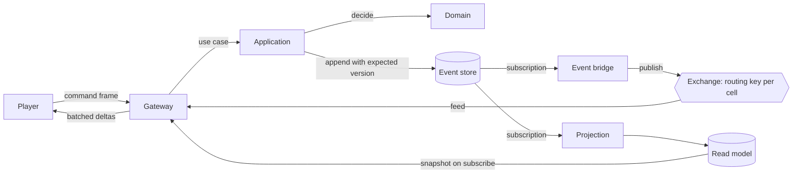

# Architecture

> **What belongs here:** how the program is put together — its layers, its modules, how a change travels
> through it, and what the fiction asks of it. **What does not:** why any of it was chosen, which is in the
> decision records, and what the game is (`VISION.md`, `SETTING.md`, `MECHANICS.md`).

Villages is an event-sourced world with a map-first client. Commands are decided by pure functions, the resulting
events are the only durable state, and everything a player sees is a projection of those events. The client is a view
over a stream of changes, not a simulation of its own.

Two separations carry the whole design. On the backend, the game domain knows nothing about Occurrent, MongoDB,
RabbitMQ or Spring. On the frontend, the game client knows nothing about React, the DOM, MapLibre or Pixi. Both are
enforced by the build and by tests, not by discipline alone.

## Dependency rules

Backend, arrows pointing the way dependencies are allowed to go:

```
domain  <-  application  <-  infrastructure-occurrent
                          <- infrastructure-rabbit
                          <- projections
                          <- gateway            <-  app
        <-  gateway (values in, HouseError out; see decision 0013)
        <-  protocol      <- gateway
```

- `domain` depends on the Kotlin standard library and nothing else. No Spring, no Occurrent, no MongoDB, no RabbitMQ,
  no CloudEvents, no Jackson, no logging framework.
- `application` depends only on `domain`. It holds the use cases and owns the ports, as interfaces, that
  infrastructure implements.
- Adapters depend inwards, never on each other, with one exception: the broker and the projections need the event
  store adapter in order to subscribe to it.
- Only `app` has a Spring Boot application class and the configuration that wires ports to adapters.

Frontend:

```
packages/protocol  <-  packages/client-core  <-  apps/web
```

- `client-core` is compiled without DOM type definitions, so a stray `window`, `WebSocket` or `document` fails to
  typecheck. The socket arrives as an injected interface.
- Restricted imports forbid React, MapLibre and Pixi inside `client-core` and `protocol`.

Enforcement: Gradle module edges plus architecture tests on the backend; workspace dependencies, a DOM-free compiler
configuration and lint rules on the frontend. A violation fails the build, in both cases proven by a deliberate
violation when the rule was introduced.

## Modules

| Module | Holds |
|---|---|
| `domain` | The house and character aggregates: commands, events, state, the decide and evolve functions, value types, domain errors |
| `application` | Use cases and the ports they need: command execution, read model queries, the clock, player tokens |
| `protocol` | The client and server message types, shared with the frontend through checked-in JSON fixtures, and the version of the wire, whose shape is recorded in `contracts/protocol-v<n>.txt` (0037) |
| `infrastructure-occurrent` | CloudEvent conversion and type mapping, the MongoDB event store, the application service, durable subscriptions |
| `infrastructure-rabbit` | Broker topology, the bridge that publishes stored events, and the feed the gateway consumes |
| `projections` | Read models. The first is houses by cell, which the map is drawn from |
| `gateway` | Player connections, cell subscriptions, snapshots, coalesced deltas, command intake |
| `app` | The Spring Boot bootstrap and the wiring. The only module that knows every other one |
| `arch-tests` | The layer rules, as tests |
| `load-bots` | The swarm that proves the scale numbers |

Packages are shorter than module names: `villages.domain`, `villages.application`, `villages.protocol`,
`villages.occurrent`, `villages.rabbit`, `villages.projections`, `villages.gateway`, `villages.app`,
`villages.bots`. The two infrastructure modules take the name of the thing they wrap, which is also their
commit scope.

Deployment starts as one process. The gateway is written as though it were already separate, so extracting it later is
a configuration change rather than a rewrite.

## What is in memory, for now

There is no MongoDB or RabbitMQ on the machine yet, so the ports have in-memory adapters: Occurrent's
in-memory event store and subscription model, wired in `InMemoryWorld`, behind `HouseCommandExecutor` and
`EventFeed`. The gateway consumes the feed in-process and fans events out to every connection that asked to
watch, which is the broker's job from increment 1.6 on. Nothing above the ports changes when the real store
and broker arrive; nothing survives a restart until then, on purpose. The whole path is proven by
`AppBootsTest`: a real socket, hello, a founded house, the event back.

## What was verified about Occurrent

Increment 0.7 compiled and ran the plan's riskiest assumption, on Occurrent 0.33.0 under Spring Boot 4.1.1:

- A Kotlin decider built with `decider(initialState, decide, evolve)` from `org.occurrent.dsl.decider` drives
  the application service through the extension `ApplicationService<E>.execute(streamId, command, decider)`,
  which loads the stream, folds it, calls decide, and appends with the stream-version write condition. A
  decision that yields no event writes nothing. **That extension is no longer what runs a command**: it gives
  no way to put anything on the envelope of what it writes, and provenance has to go there, so the executor
  does those four steps itself and retries a lost write three times as the extension did. See decision
  record 0035. The smoke test still proves the library's own path works.
- `GenericApplicationService(eventStore, cloudEventConverter)` is the constructor, and
  `JacksonCloudEventConverter.Builder<E>(objectMapper, source).typeMapper(...)` builds the converter on
  Jackson 3. The house events get their own type mapper in 1.5, so the CloudEvent type can be
  `villages.house.founded.v1` rather than a class name.
- Occurrent pins `jackson-databind` 3.1.4 and Spring Boot 4.1.1 manages 3.1.5; Gradle resolves to 3.1.5 and
  the round trip works on it. CloudEvents is 4.0.1. The in-memory store is `InMemoryEventStore()`.

## How a change travels



A player arrives and is asked something. Saying hello with no house and nothing pending writes
`PlayerGivenChoice` to their house's stream, and the gateway answers with what it gave rather than with a
read of the projection, because the projection folds on another thread and would sometimes say
"nothing" about a choice just written. Taking one option writes the action and what it does from one
decision, at consecutive versions and under one correlation id, and the map's read model draws the
founding out of that. See decision records 0034 and 0035.

A player founds a house. The gateway hands the command to the application, which loads the stream, calls `decide`,
and appends the resulting events with the stream version as the write condition. Two subscriptions read the store from
there: one updates the read model, one publishes to the broker with a routing key that carries the cell. Every gateway
node consumes that feed, matches each event against the cells its sessions are watching, and pushes a coalesced batch.
A newly subscribed client is served a snapshot from the read model first, and drops any delta it has already seen.

There is no outbox table and no dual write. The append to the stream is the only write there is, and the
event is the change rather than a notification about one, so the store *is* the outbox and the subscription
is the relay. What a relay owes is delivery: a feed says where it begins - everything, for a read model that
is the fold of every event, or only what follows, for a watcher - and one that begins at the beginning
subscribes before it replays, so an event appended in between arrives twice rather than not at all. Folding
an event twice is harmless. See decision record 0029.

A player has one session. The gateway keeps one connection per player, and a second hello takes the player
over: the newcomer becomes the session and the one before is stood down, told so, and dropped from every
cell it held. What a session holds - its cells, the day it is looking at - is its own; what is the
player's, which today is which house is theirs, is sent to whichever window they are in. See decision
record 0028.

Today there is no broker. The read model's own change stream stands in for the exchange: the gateway watches
the projection for changes and queries it for snapshots, both through the `HousesByCell` port. When RabbitMQ
arrives the exchange takes over the fan-out between processes, and the gateway's side does not change - it
still holds an index from cell to sessions and, for each changed house, walks that house's deepest cell up
through all of its prefixes, sending to the holders at the zooms its significance is worth drawing at and to
anyone who is seeing everything at the rest. A cell is a quadkey at any zoom, so a client asks for data on
the same grid, at the same zoom, as the terrain tiles it draws; see decision record 0026.

Seeing everything is a connection's, not a house's: `seeAll` sets significance aside for whoever sent it, so
the same house is in a coarse cell for one session and not for another. It is a way of looking rather than a
fact about the world, which is why nothing about it is stored or recorded. The player's eye is a different
thing and needs no frame at all: a player's own house reaches their session rather than a cell, so keeping
it in sight is a page drawing what it already has. See decision record 0038.

## What acts on its own

Two things in the program act without anybody sending a command, and they keep the same rules: one
subscription to the feed from the beginning, with a fold of their own rather than a read of a read model,
because two subscriptions can stand at different points in the feed; commands issued through `Later`,
never inside the feed's own callback; no cancellation table; and every refusal that means "already done"
swallowed, which is what makes a replay write nothing twice.

- **The pledge release**, `Pledges`, waits out a pledge's span and gives it back: one wake-up a pledge, at
  the moment it is due, and none without one. See decision record 0053.
- **The mourning**, `Mourning`, writes a character's death into every house that held them as a key
  figure, in the death's own story, and undoes a tie made to somebody already dead. It is how a death on a
  character's stream reaches the houses' streams, which no one decision can write together. See decision
  record 0055.

## Scale principles

1. One stream per house and one per character (decision 0055), and no global aggregate. Anything
   world-shaped is a projection.
2. Resources are rates. Events are emitted when something changes, never on a clock, so idle players cost nothing.
3. The world is partitioned into cells, at every zoom: a quadkey, so a cell's ancestor is its prefix. Routing keys,
   subscriptions and read model queries all derive the cell from the place on the event by one shared function,
   mirrored in the browser and held to shared vectors. An event carries where it happened and how much it matters,
   never a cell; how far out a thing is drawn comes from its significance. See decision record 0026.
4. Gateway nodes are stateless apart from their live connections: one broker consumer per node, an in-memory index
   from cell to sessions, and no stickiness required from a load balancer.
5. Pushes are coalesced per session on a short timer, and outbound queues are bounded. A client that cannot keep up is
   told to resynchronise rather than being allowed to grow a queue.
6. The map is drawn from read models. The event store is never queried to render anything.
7. Every principle above is checked by the bot swarm, not assumed. Ten thousand connections on one development
   machine is the number to prove, and proving it is on the roadmap under Later rather than next.

## The fate engine

Nothing of this is in the source yet. It is here rather than in `SETTING.md` because it is a part of the
program rather than a part of the fiction, and `MECHANICS.md` points at it from the mechanics it drives.

The **fate engine** rolls what could happen to a house at a moment. Its inputs are the house's stats, its
house-spirit, where the player is looking and what is around there; its output is a set of options of
comparable value, each with a rarity, which reaches the player as a **choice roll**. It is one side of a coin
whose other side is that mechanic, so what is asked of one is asked of the other: enough rolls that repeats
are not noticeable, and never a legendary option sitting beside two commons.

Two things follow for the architecture, and neither is built:

- A roll is **not** a decision of the domain. The engine proposes; the player disposes; only the taken option
  becomes an event. The giver of a choice is application code, as arrival is today, and the roll is what a
  giver consults. See decision record 0034 for the pattern it plugs into.
- A rolled option can name a thing that does not exist yet. Because play is chronological, that thing is
  simply created going forward - there is nothing to reconcile with the past, and no constraint solver.

## What the setting asks of the architecture

`SETTING.md` describes a world; two of its demands are not yet met, and are recorded here so that the first
increment to touch either starts from them.

1. **Things with lifetimes are their own streams.** A cathedral raised by one house and ended by another is
   shared state, so it cannot live inside a `House`. Places, structures and characters become aggregates
   with a lifetime `[from, to)` in world-time. One stream per house becomes one stream per thing that can
   exist. **A key figure is not one of them**: it is a tie between a house and a character, written in the
   house's own history, so the house keeps its own rules about whom it holds. Characters are the first,
   decided in decision record 0055 before any code; each later kind gets its record the same way.
2. **The map is a temporal read model.** Rows carry `since` and `until` in world-time, and the map at
   world-time T is a range query: `since <= T < until`. Decided and built for houses with decision record
   0027. A character, who moves and dies, is the first thing to use the other half of it: the characters
   projection keeps a **span** for every stretch a character stood in one place, closed by a move, by
   leaving the map or by death, and a cell at T is the spans that hold T (0055).

A third demand, a resource that ticks, already has its answer: a resource is an amount, a rate per second and
the instant at which that was true, and an event is recorded when the rate changes rather than on a clock.
See decision record 0006. **What** the resources are is now settled too - wealth, domain, influence, reason
and piety, one `Stock` apiece - and every rate among them is zero, because nothing in the world generates
income yet. The shape is carried anyway so that income, when it arrives, is a number changing rather than a
frame changing. See `SETTING.md` and `GLOSSARY.md` for what each of the five is.

## What showing a dialogue asks of the client

Nothing of this is built. `MECHANICS.md` describes **character dialogue**; what follows is what it would
cost the client, recorded before anything is written so that the first increment starts from it.

**Where it would be drawn is an open choice, and it matters.** PixiJS is in exactly one file today,
`sprites/PixiSpriteRenderer.ts`, and it draws the map overlay behind the `SpriteRenderer` interface. Every
other piece of interface, the parchment included, is React and the DOM. A dialogue is interface rather than
map, so the DOM is where it would naturally go — but the mechanic exists for its feel, and characters that
enter, leave and react are what Pixi is for. The two routes:

- **DOM and CSS.** Simplest, responsive for free, animation limited to what CSS transitions and transforms
  give. Nothing new in the stack.
- **A Pixi surface inside the panel.** Sprite sheets, tweens and per-character animation, at the cost of
  another WebGL surface beside the map's and a layout that has to be driven rather than declared.

Whichever is picked gets a decision record, because it is hard to reverse once a dozen conversations are
written against it.

**The stepping belongs in `client-core`, not in the page.** Which line is current, who is speaking, what a
step does and when an opportunity opens mid-conversation is logic with no DOM in it, so it sits in
`packages/client-core` behind the layer rule and is tested without a browser. `apps/web` draws what that
logic says. A dialogue that keeps its state in a React component is a dialogue that can only be tested by
clicking through it.

**It is responsive from the first line of it.** On a phone a dialogue is the screen; on a desktop it is a
region of it. See `RESPONSIVE-DESIGN.md`.

What the server owes a dialogue is undecided, because whether the lines themselves are events is undecided;
`MECHANICS.md` says so under the mechanic.

## What the bays ask of the client

The stage is a map with a column of bays lying on it, and one rule places them at every size; decision
record 0040 says why, and `RESPONSIVE-DESIGN.md` says what it looks like. What it costs the client is small
and specific.

**The layout is arithmetic, in a module of its own, with a test.** Given the stage's size and what each pane
asked for, out comes which side the column is on, how big it is, and every bay's box. No DOM, no React,
nothing to click: the
same shape as `stageBox.ts`, which is the stage's own arithmetic and is pure for the same reason. It stays
in `apps/web` rather than moving down to `client-core`, because the layer rule is there to keep *game* logic
testable without a browser and this is presentation arithmetic that would mean nothing to a headless client.
The test is what makes it reviewable; the component only renders what it is handed.

**A pane is declared, not positioned.** A pane says what it is called, the mark it is known by, which tile
of the spread it belongs in, how tall that tile is at each of its sizes, and - where it has one - what its
full form needs before it has to draw itself smaller. The layout places it. Nothing in the layout knows
what a map is, and no pane learns where it is beyond the room it was given, which is what lets a ui
mechanic be written once and drawn at every size.

**A pane declares nothing about a phone.** How the two bays divide the stage is one value with three
settings, held by the fold: a strip and the rest, half each, or the rest and a strip. A bay is one end of a
stage two panes are sharing, so what is standing in it has nothing to say about how much of it there is -
which is what makes moving a pane between bays free, and what makes the three sizes mean the same thing on
every pane. A tile in the spread is the other case and keeps its own heights, because nothing is competing
for the room there. See decision record 0046.

**Two panes naming the same bay share it**, and that is the whole of how a bay holds more than one. The
panes declare it rather than the layout deciding it when they stop fitting, so a tab cannot appear and
vanish as a window is dragged. **Whether they take turns or stack is the bay's property** - the rail stacks
its windows, everywhere else the panes are alternatives behind a tab bar - and the arithmetic learns only
that a tabbed bay is a strip taller than whichever pane is up in it. See decision record 0042.

**Nothing is unmounted to move it.** A pane changes bays by changing which cell of a grid its wrapper sits
in, not by being torn down and rebuilt elsewhere. That matters for exactly one pane and it matters a lot:
`MapView` calls `map.remove()` when it unmounts, and MapLibre holds the camera, the style and a WebGL
context, with the sprite overlay's Pixi canvas beside it. One DOM tree and no portals is the whole
technique, and it is free because everything on the stage is already `position: absolute; inset: 0` - a pane
only ever needed a positioned box around it, and the stage was already that box.

**The camera is told what the column covers.** The column lies on the map rather than taking room from it,
so the map's visible middle is not its geometric middle. Whatever flies the camera reads the layout's answer
for that, in one place, rather than every caller guessing.

**Which bay holds what is where the player is, not a preference.** It is a module store with a listener
set, like the gateway and the selection and the areas, and a reload forgets it. **The trail does survive a
reload**, because a trail that empties itself is not a trail, and it is the only thing on the stage that
does; what comes back from storage is checked rather than trusted, because a previous version of the code
wrote it. What persists besides that - the phone toggle, the folded sections - is Adam's and lives in
`debug/stage.ts`.

## Events over time

Event types are versioned by name and catalogued in the event catalogue, which a test parses. Until the
world-persistence milestone the store may be wiped instead of migrated, which is what makes early experimentation
cheap; after it, changes need upcasters. The decision records carry the reasoning.
