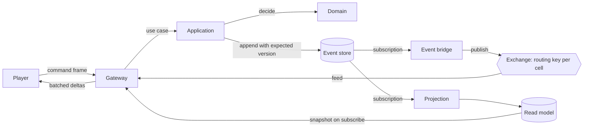

# Architecture

> **What belongs here:** how the program is put together — its layers, its modules, how a change travels
> through it, and what the fiction asks of it. **What does not:** why any of it was chosen, which is in the
> decision records, and what the game is (`VISION.md`, `SETTING.md`, `MECHANICS.md`).

Villages is an event-sourced world with a map-first client. Commands are decided by pure functions, the resulting
events are the only durable state, and everything a player sees is a projection of those events. The client is a view
over a stream of changes, not a simulation of its own.

Two separations carry the whole design. On the backend, the game domain knows nothing about Occurrent, MongoDB,
RabbitMQ or Spring. On the frontend, the game client knows nothing about React, the DOM, MapLibre or Pixi. Both are
enforced by the build and by tests, not by discipline alone.

## Dependency rules

Backend, arrows pointing the way dependencies are allowed to go:

```
domain  <-  application  <-  infrastructure-occurrent
                          <- infrastructure-rabbit
                          <- projections
                          <- gateway            <-  app
        <-  gateway (values in, HouseError out; see decision 0013)
        <-  protocol      <- gateway
```

- `domain` depends on the Kotlin standard library and nothing else. No Spring, no Occurrent, no MongoDB, no RabbitMQ,
  no CloudEvents, no Jackson, no logging framework.
- `application` depends only on `domain`. It holds the use cases and owns the ports, as interfaces, that
  infrastructure implements.
- Adapters depend inwards, never on each other, with one exception: the broker and the projections need the event
  store adapter in order to subscribe to it.
- Only `app` has a Spring Boot application class and the configuration that wires ports to adapters.

Frontend:

```
packages/protocol  <-  packages/client-core  <-  apps/web
packages/world                               <-  apps/web
```

- `client-core` is compiled without DOM type definitions, so a stray `window`, `WebSocket` or `document` fails to
  typecheck. The socket arrives as an injected interface.
- Restricted imports forbid React, MapLibre and Pixi inside `client-core` and `protocol`.
- The world package is the generator, and it has three doors: `@villages/world`, what the page reads and draws
  a world with; `@villages/world/build`, everything the world is made with besides, for the tools in its `bin`
  and the tests that build a world; and `@villages/world/testing`, its worked examples. A page file that takes
  from either of the last two is a lint error. Its `src` is pure and typechecked without Node. Its tools share
  their readers in `bin/lib/` - one of a master, `master.ts`, so that a colour is the same class to the tiles,
  the sprite map and the stills, and one of their arguments, `flags.ts` - and the libraries only they use,
  pngjs, fflate, shapefile and sharp, are its development dependencies.
- The session - what the page knows of the world and of its own house, and what it asks of the gateway - is
  `client-core`'s, `createSession`, so it is tested without a browser, and whatever it needs from the outside is
  handed in (0078). Its state is folded from **slices**, one a mechanic, in `slices.ts`: the connection, the cells,
  the house, the choice, the key figures, the sight, the dialogues, the commands and the two switches - see
  everything and the fog, held there once and said again at every welcome - each with what it starts as, how a
  frame changes it, and what an end does to it - a close keeps the cards and a takeover forgets them. What a
  frame makes the session do goes through one table in `session.ts` that names every kind of frame. The follower
  is its part that asks for the cells the camera wants and lets go of the old ones late, only once what replaces
  them has answered, with its clock handed in as a `Schedule`. `commands.ts` is the one way a command goes out,
  in two lanes - the player's, one at a time, and the levers', which the debug panel's `debug/levers.ts` pulls -
  each filed under the part of the log it was asked from, with its answer beside it; and `canAct`, which the
  choice's pane and the dialogue's both ask before they let anything be pressed. The page's `net/gateway.ts` is
  only the browser's wiring - the socket, the timers, the storage, the reload and the master - and
  `net/gateway.test.ts` holds the page to the same conversation as before.
- The log listens to the session rather than being written inside it: `observeGateway` tells a listener of every
  frame once the state has taken it in, with the state as it was, before what the frame makes the session do and
  after it, and of the connection opening and closing. `sessionLog.ts`, at the root of `apps/web`, is that
  listener, and holds every word the frames are said in.
- Every piece of state the page watches is one shape: a store from the core's `createStore`, kept by the module
  that owns it and handed out read-only as a `Readable` - `sessionStore`, `baysStore`, `cameraStore` and the
  rest - and changed only through that module's own functions, which say why. A component reads one through
  `useStore(store, select)`, in `src/store/`, and picks what it uses, so a frame that changed something else does
  not draw it again. The component library keeps its one store of its own, because it leans on nothing.
- Inside `apps/web`, the component library in `src/ui/` imports nothing from the rest of the app: the game hands it
  words, numbers and callbacks. A test reads every import in the folder and fails on one that leaves it, bar React,
  the fonts and the world package's pure rules and types, which is what lets `/admin/inspect-ui-components` show every component with nothing running. See
  decision record 0068.
- The rest of `apps/web` stands in rows, and a folder imports only the rows above it, and in its own row only what
  the rule names: `ui`, `version`, `marks`, `log`, `geometry`, the ground's own measures, and `shaders`, how much
  the map's shaders draw, which lean on nothing in the page; `net` and `stage`; the ground drawn, `map`, `fog`, `desk` and `water`; what stands on it,
  `sprites` and `room`; the game's own surfaces, `house`, `figures`, `choice`, `dialogues`, `areas` and `inspect`;
  and what puts it all together, the root, `debug` and `admin`. No two files import each other, however far round.
  `src/layers.test.ts` holds it. The component library in the top row is imported by `admin`, which shows it,
  and by `stage`, which dresses each tile in a container (`stage/dress.ts`); no surface imports it yet. The
  inspect pages in `admin` are cordoned off beyond that: nothing in the game imports them, the entry reaches
  them only with `import()`, and the libraries they carry are theirs alone (`src/admin/boundary.test.ts`, 0091). The imports that broke it on the first day were listed one by one and each
  ended by a step of the plan; none is left. What a surface needs from another surface is handed down: an
  overlay on the map is handed what the map marks and what a pick does, and a pane what it shows beside
  itself. See decision record 0073.
- The page's stylesheet, `styles.css`, is an ordered list of the parts each folder keeps of it -
  `stage/bays.css`, `house/house.css`, `dialogues/conversation.css` and the rest - and the order is the cascade:
  a part later in the list wins over an earlier one for a rule of the same weight, and the strips come last. A
  new rule goes in its folder's part, and a new part where it cascades. The size cap holds each part to 400 lines.
  The stage's rules name no pane: a pane put away draws the one strip, `.pane-strip`, the element that is its
  card in a tabbed tile is marked `.pane-card`, and how a pane fills a bay is said in its own part.
- Nothing in the game leans on `debug`. A setting the panel changes and the game reads lives beside what reads
  it - the camera in `map/camera.ts`, the scenery's dial in `sprites/scenery/settings.ts`, the stage's
  arithmetic in `stage/stageBox.ts` - and the panel only sets it, so without the panel each stays where a player
  has it. **And a player's build has no panel**: `main.tsx` asks for `debug/devTools.ts` - the panel, its grips,
  their arrangement and their stylesheet - only in a development build, so a production build leaves all of it
  out, and `App.tsx`, handed nothing, lays the stage out over the whole window (0079).

Enforcement: Gradle module edges plus architecture tests on the backend; workspace dependencies, a DOM-free compiler
configuration and lint rules on the frontend. A violation fails the build, in both cases proven by a deliberate
violation when the rule was introduced.

## Modules

| Module | Holds |
|---|---|
| `domain` | The house, character and structure aggregates: commands, events, state, the decide and evolve functions, value types, domain errors |
| `application` | Use cases and the ports they need: command execution, read model queries, the clock, player tokens |
| `protocol` | The client and server message types, shared with the frontend through checked-in JSON fixtures, and the version of the wire, whose shape is recorded in `contracts/protocol-v<n>.txt` (0037) |
| `infrastructure-occurrent` | CloudEvent conversion and type mapping, the MongoDB event store, the application service, durable subscriptions |
| `infrastructure-rabbit` | Broker topology, the bridge that publishes stored events, and the feed the gateway consumes |
| `projections` | Read models. The first is houses by cell, which the map is drawn from; the sight is what every house can see, which the fog of war is drawn from |
| `gateway` | Player connections, cell subscriptions, snapshots, coalesced deltas, command intake through one registry, `Commands`, and Adam's instruments as a part of their own, `Instruments`, which `villages.instruments` closes (0076) |
| `app` | The Spring Boot bootstrap and the wiring. The only module that knows every other one |
| `arch-tests` | The layer rules, as tests |
| `load-bots` | The swarm that proves the scale numbers |

Packages are shorter than module names: `villages.domain`, `villages.application`, `villages.protocol`,
`villages.occurrent`, `villages.rabbit`, `villages.projections`, `villages.gateway`, `villages.app`,
`villages.bots`. The two infrastructure modules take the name of the thing they wrap, which is also their
commit scope.

**A mechanic has one place in each layer**, and a file that serves every mechanic routes to those places
rather than holding them (0075). In the domain, a mechanic's events are a family, `ResourceEvent` and its
siblings, which a fold with nothing to say about it passes in one branch, and its commands a family beside them,
which `HouseDecider` hands to the part of the house that decides them - the `Treasury`, `KeyFigures`,
`Visions`, `Dialogues` - and that part alone folds its events; a part reaches another only through the
effects it asks of the house, `Follow`; in the read models, its own
projection; in the gateway, a part of its own, `HousesPart` and the rest beside the core in `Gateway.kt`, which
greets a player arriving, takes its commands and frames and watches its read models, and a file for what its
frames say, `HouseViews.kt` and the rest. What goes
where, for a new one, is the checklist in `BUILDING-A-MECHANIC.md`.

Deployment starts as one process. The gateway is written as though it were already separate, so extracting it later is
a configuration change rather than a rewrite.

## Where the world is kept

An `EventWorld` is the store, its subscriptions and the ports over them - `HouseCommandExecutor`,
`CharacterCommandExecutor` and `EventFeed` - and there are two. `MongoWorld` keeps the world in MongoDB,
through Occurrent's store and its subscriptions on the database's change streams, so it outlives the server.
`InMemoryWorld` keeps it in Occurrent's in-memory store, so it is gone when the server stops, which is what
every test wants and what the app runs on when it is not told otherwise. `StoreConfig` chooses, by
`villages.store`, and nothing above the ports can tell which it was handed.

MongoDB and RabbitMQ run on the machine, one of each from `infra/docker-compose.yml` for every tree (0092).
A tree's server keeps its world in a database of the tree's own, `villages` in the main checkout and
`villages-<tree>` in a worktree, which it works out from the checkout it runs in, so two sessions running
at once never see each other's world. The quick start starts the stack when it is not running and passes
`villages.store=mongo` whenever Docker is up, and the welcome says where the world is kept, which the
debug panel prints.

RabbitMQ is not used yet. The gateway consumes the feed in-process and fans events out to every connection
that asked to watch, which is the broker's job from increment 1.6 on, in a virtual host of the tree's own.
The whole path is proven by `AppBootsTest`: a real socket, hello, a founded house, the event back; the
store itself by `MongoWorldDockerSpec`, against a MongoDB of its own in a container.

## What was verified about Occurrent

Increment 0.7 compiled and ran the plan's riskiest assumption, on Occurrent 0.33.0 under Spring Boot 4.1.1:

- A Kotlin decider built with `decider(initialState, decide, evolve)` from `org.occurrent.dsl.decider` drives
  the application service through the extension `ApplicationService<E>.execute(streamId, command, decider)`,
  which loads the stream, folds it, calls decide, and appends with the stream-version write condition. A
  decision that yields no event writes nothing. **That extension is no longer what runs a command**: it gives
  no way to put anything on the envelope of what it writes, and provenance has to go there, so the executor
  does those four steps itself and retries a lost write three times as the extension did. See decision
  record 0035. The smoke test still proves the library's own path works.
- `GenericApplicationService(eventStore, cloudEventConverter)` is the constructor, and
  `JacksonCloudEventConverter.Builder<E>(objectMapper, source).typeMapper(...)` builds the converter on
  Jackson 3. The house events get their own type mapper in 1.5, so the CloudEvent type can be
  `villages.house.founded.v1` rather than a class name.
- Occurrent pins `jackson-databind` 3.1.4 and Spring Boot 4.1.1 manages 3.1.5; Gradle resolves to 3.1.5 and
  the round trip works on it. CloudEvents is 4.0.1. The in-memory store is `InMemoryEventStore()`.
- The in-memory subscription model's `cancelSubscription` forgets a subscription without stopping it: its thread
  polls for as long as the process runs, and the model's `shutdown()` waits five seconds for it and gives up.
  Occurrent's master stops the subscription on cancel, and no release has that yet. Until one does,
  `InMemoryWorld` stops a cancelled subscription itself and wakes the threads when it shuts down, so a world
  closes at once, the server stops without the wait, and no test that closes a world waits five seconds for it.
  Both go when a release has the fix.
- Increment 0.8 ran the MongoDB half, on the driver itself rather than Spring Data:
  `MongoEventStore(client, database, collection, EventStoreConfig(timeRepresentation))` and
  `NativeMongoSubscriptionModel(database, collection, timeRepresentation, executor, retryStrategy)`, from
  `occurrent-eventstore-mongodb-native` and `occurrent-subscription-mongodb-native-blocking`, on the Mongo
  driver 5.8.1 Spring Boot manages. Kept as `DATE`, a time finer than a millisecond is refused outright, so the
  time is `RFC_3339_STRING`, and every catalogued event comes back from MongoDB as it was written. The store's
  `WriteConditionNotFulfilledException` is the in-memory one's, so the executor's retry works unchanged.
  Testcontainers 2.0's `MongoDBContainer` is a lone server unless asked `withReplicaSet()`.
- The native subscription model turns each change into a CloudEvent outside its retry of the subscriber, so a
  change it cannot read back fails the whole subscription, which its retry strategy starts again from the same
  change: with `RetryStrategy.fixed`, forty times a second for ever. The strategy is also what restarts a
  subscription after MongoDB itself fails, so it cannot simply be limited. `MongoWorld` retries MongoDB's own
  exceptions for ever, backing off to five seconds, and gives up at once on anything else, saying so through
  `onError`, whose `ErrorInfo.isRetryable` is false only on the last. A subscription given up on is stopped for
  good. See decision record 0036.

## How a change travels



A player arrives and is asked something. Saying hello with no house and nothing pending writes
`PlayerGivenChoice` to their house's stream, and the gateway answers with what it gave rather than with a
read of the projection, because the projection folds on another thread and would sometimes say
"nothing" about a choice just written. Taking one option writes the action and what it does from one
decision, at consecutive versions and under one correlation id, and the map's read model draws the
founding out of that. See decision records 0034 and 0035.

A player founds a house. The gateway hands the command to the application, which loads the stream, calls `decide`,
and appends the resulting events with the stream version as the write condition. Two subscriptions read the store from
there: one updates the read model, one publishes to the broker with a routing key that carries the cell. Every gateway
node consumes that feed, matches each event against the cells its sessions are watching, and pushes a coalesced batch.
A newly subscribed client is served a snapshot from the read model first, and drops any delta it has already seen.

There is no outbox table and no dual write. The append to the stream is the only write there is, and the
event is the change rather than a notification about one, so the store *is* the outbox and the subscription
is the relay. What a relay owes is delivery: a feed says where it begins - everything, for a read model that
is the fold of every event, or only what follows, for a watcher - and one that begins at the beginning
subscribes before it replays, so an event appended in between arrives twice rather than not at all. Folding
an event twice is harmless. The hand-over from the history to what arrives live is one lock, `Handoff`, so
nothing that arrives meanwhile is lost, it follows the history in the order it came, and a subscriber is never
handed two events at once; an event that cannot be read is said once as a fault. See decision record 0029.

A player has one session. The gateway keeps one connection per player, and a second hello takes the player
over: the newcomer becomes the session and the one before is stood down, told so, and dropped from every
cell it held. What a session holds - its cells, the day it is looking at - is its own; what is the
player's, which today is which house is theirs, is sent to whichever window they are in. See decision
record 0028.

Today there is no broker. The read model's own change stream stands in for the exchange: the gateway watches
the projection for changes and queries it for snapshots, both through the `HousesByCell` port. When RabbitMQ
arrives the exchange takes over the fan-out between processes, and the gateway's side does not change - it
still holds an index from cell to sessions and, for each changed house, walks that house's deepest cell up
through all of its prefixes, sending to the holders at the zooms its significance is worth drawing at and to
anyone who is seeing everything at the rest. A cell is a quadkey at any zoom, so a client asks for data on
the same grid, at the same zoom, as the terrain tiles it draws; see decision record 0026.

The fan-out runs inside the read model's watchers, and a throw there leaves the fan-out before the
connections after it are told. A send therefore never throws into the gateway. A frame for a socket that is
going is simply not delivered, and the close on its way lets the connection go. Tomcat says a session is
open while it is closing, and a seeding connection closes the moment its command is accepted, which is while
its house is still being fanned out.

Anything else a subscriber throws is a **fault**, and the feed says so rather than losing it: the server's
log gets the stack under `villages.feed`, every window's debug panel gets the one line as `error fault`,
and the feed goes on to the next event without handing that one to that subscriber again. The read model
is then missing the event, which is why the fault has to be seen. Whatever else acts on its own says so the
same way: a listener's work, and anything scheduled for later, which used to throw into a future nobody
read. They all report to one board, `Faults`, which the log and the gateway watch. See decision record 0029.

Seeing everything is a connection's, not a house's: `seeAll` sets significance aside for whoever sent it, so
the same house is in a coarse cell for one session and not for another. It is a way of looking rather than a
fact about the world, which is why nothing about it is stored or recorded: with the day the scrubber is on and
the fog, one value a connection, `Looking`, replaced whole so that no fan-out reads half of a change (0075). The player's eye is a different
thing and needs no frame at all: a player's own house reaches their session rather than a cell, so keeping
it in sight is a page drawing what it already has. See decision record 0038.

## What a house sees

The fog of war is one read model and a frame. `SightProjection` folds every house's **vision points** from
the feed - its seat from the founding, and each key figure for every stretch they stand in one place while
they are the house's - and works them out rather than recording them, because the world already records
where a seat is and where a person stands. Vision given outright is recorded, because nothing else records
it: `house.gainedVision` and `house.lostVision`, read straight off the events. The gateway sends a house's points to its player as `yourSight`,
on hello and whenever one opens or closes, the way it sends `yourHouse`: to the session, never to a cell.

The server is the one place a sight is worked out. The page draws the fog from what it is sent, and the
gateway asks the same sight before it sends anything, so what is drawn and what is held back cannot disagree.
`Fog`, in the gateway, is decision 0061's table: a house on revealed ground, a person in vision, a player's own
house and key figures always, and anything of significance 80 from anywhere. The read models ask it before a
cell's cap, so hidden houses never crowd out one that may be sent and are never counted, and the fan-out asks
it before every delta; a change to a house's sight answers every cell its player holds again. A vision
point's size is kilometres on the ground, and how far that reaches on the map is `Reach`, beside the cells in
`protocol` and in the TypeScript package for the reason the cells are there: both ends compute it
identically, against `contracts/fixtures/reach.json`. Several points together, with the **surface tension**
between them (0064), are `Coverage`: every circle and whatever a ball of the tension's size cannot get into,
answered exactly for one place at a time by the gateway and the page's marks alike, against
`contracts/fixtures/coverage.json`. The fog's distance field comes to the same edge for a whole grid at once,
through a distance transform. See decision record 0061, and
`docs/plans/fog-of-war.md` for what is built.

A **structure's** face can change, so the structures' read model keeps every face it has had over world-time, and
answers a cell with all of them; the gateway picks one per house with `Fog.faceOf`: the face of the day asked where
the house sees, the face it had when the fog hid the place - `Fog.hidOn`, shared with houses - on revealed ground,
none elsewhere. Each face is stamped with the read model's count of changes, and a snapshot carries the count it was
read at, so a page holding a newer face than a snapshot sends still lets the snapshot's replace it. See decision
records 0061 and 0092.

The scenery's **stands** take the same road (0067). `hello` names the master the page draws; the gateway
reads that master's stand files through the `Stands` port, whose adapter in `app` reads them from
`world/stands/`, where the generator writes them and nothing serves them, picks the master among that
folder's own entries and keeps each tile once read, and sends every zoom 7 tile under a held cell as a `stands`
frame of the sprite map's own eight-byte records, only those whose disc comes within the scatter's margin of
revealed ground. `Coverage.reaches` is that question, answered by growing every circle; `StandRecords` in
`protocol` and `decodeStands` in the world package read the records alike, against
`contracts/fixtures/stands.json`. A sight change or the switch answers every held tile again, sending only
what changed. The page grows its scenery from those and nothing else: `net/stands.ts`
keeps a tile exactly as long as the gateway thinks it was sent, by `standTilesUnder` at both ends against
`contracts/fixtures/stand-tiles.json`, and a scatter cell waits for every tile it reads. A tile sent again
differently makes every cell cut from its old records stale, and one already on the screen keeps its points
until the new ones are cut, so nothing blinks while the fog moves.

**The fog is a layer of the sprite canvas**, `sprites/FogLayer.ts`, drawn between the world and the signs for
the things in it: the scenery and whatever stands outside vision under it, every icon and whatever stands in
vision over it (0063). It asks the projection in `geometry/cameraMath.ts` backwards for the ground under each
pixel, and reads there a distance field of the vision points, worked out in the browser once for each change
to them (`apps/web/src/fog/`) and handed to the graphics card as one small half-float texture. Nothing about
the fog is worked out while the camera moves except that one pass. See decision record 0062. The scenery
layer asks the same field where it may grow (`revealedAt`), as a cell is taken into view and again when the
fog changes, so no tree stands in the haze; the scatter itself stays a pure function of the ground and the
stands it was sent, which on revealed ground are every stand that could change it.
**Revealed ground loses its colour in each canvas** (0065): the map's through `.uncolouring`, a 2D canvas
between the map and the sprites that `fog/uncolouring.ts` lays a grey picture of the field on, blended by the
browser's saturation blend, and the sprites under the fog by a filter on the container that holds them. The
fog shader's code for where a pixel lies and how far inside each edge is shared by the fog and the filter.
**The sprite canvas is a stack of layers**, each a `Layer` (`sprites/layer.ts`): the scenery, the marks under
the fog and over it (`MarksLayer.ts`), the fog with the haze's clock, the selection ring (`RingLayer.ts`), and
the colour taken out of the map on its own canvas. Each draws its part of a frame from the same camera and says
how soon it wants the next - the next frame, a time, or never - and the renderer asks for the soonest. So the
canvas draws when the map has drawn and has no clock of its own, except the haze's: while the fog is drawn close
in with unknown ground on the screen, it asks for a frame twelve times a second, so the haze can drift, and stops
asking the moment there is none. The page hands it the whole scene at once (`setScene`) and it works out what
changed and asks for one frame, so however much changes together, it draws once. A new way of drawing is a
layer of its own and a line in the renderer's stack, where it goes in the drawing's order. **A new kind of
thing standing on the map is a kind of mark instead**: the marks layer is the same for every kind - the trade
between two forms, the fade in and out, the side of the fog, the click and the ring - and what differs, the
pictures, the heights of the two forms and where a pennant flies, is its look (`sprites/markLooks.ts`). A
structure was the first added that way; one mark's own sprites and what is done to them alone are
`markEntry.ts`.
**The water is not in the sprite canvas but in the map**, a MapLibre custom layer (`water/WaterLayer.ts`) drawn
in WebGL2 over the painted terrain and under the ink lines, so the fog and everything in the sprite canvas are over
it (0081). Where the water is comes from the flat tiles, a mask a tile worked out in the browser by the fog's
distance transform (`water/waterMask.ts`); which way the rivers run comes from flow tiles that `world:flow`
writes beside the cut tiles, worked out offline from the master because it is a fact about the whole network
(`packages/world/src/flow.ts`). Everything that moves is worked out in its fragment shaders from the ground's
own coordinates. It has a clock of its own, while some of it is on the screen and none otherwise, and it asks
the map, not the sprite canvas, for frames. Each such shader is drawn at a level, `shaders/levels.ts`, off, low or
high: at low the water is drawn into a picture of its own at half the map's width and height and laid over the
map (`water/picture.ts`), at half the frame rate, and the grass, in the sprite canvas, the same way.
**The relief is in the map too**, a custom layer of its own (`map/reliefLayer.ts`) between the painted terrain
and the water, beside MapLibre's own hillshade, which is kept to compare (0090). It reads the height tiles
`world:height` cuts from ETOPO 2022, read through the master's origin map, into a texture a tile with a margin of its neighbours' (`map/reliefTiles.ts`):
asked for a view at a time, a few at once, a coarse cover first and then from the middle out, cancelled when the
view moves on (`map/reliefQueue.ts`); drawn before its neighbours land, with its own ground carried past the edge
until they do (`map/reliefMargin.ts`); and stood in for by a coarser tile, or finer ones, while it is on its way.
It works the shade out in its fragment shader for every pixel, or for every cell of the ground's lattice; how
strongly at each zoom is a curve (`map/reliefCurve.ts`). It has no clock: it draws when the map does. The water
and the relief link their programs and draw their tiles with the same few helpers, `shaders/webgl.ts`.

## What acts on its own

Four things in the program act without anybody sending a command, and they keep the same rules: one
subscription to the feed from the beginning, with a fold of their own rather than a read of a read model,
because two subscriptions can stand at different points in the feed; commands issued through `Later`,
never inside the feed's own callback; no cancellation table; and every refusal that means "already done"
swallowed, which is what makes a replay write nothing twice.

Those rules are kept once, in **`Reaction`**, which each of the four is: `issueLater(what, settled)`
plans a command on `Later`, swallows the refusals the caller names as meaning "already done" and the want
of a house a wipe took, and reports anything else - a write conflict the executor could not get past
included - as a fault under the reaction's name and what it was doing. What it writes continues the story
of what it heard, `Provenance.continuing`.

They and the read models are all a **`Follower`**: it subscribes from the beginning when it is started and
not when it is made, so that it has finished being made before the history reaches it, and the app starts
each one as its bean is made, `initMethod = "start"`, which `FollowersTest` holds every one of them to. A
follower is `Resettable`, and the development world's wipe empties every `Resettable` there is rather than a
list of names, which is how the pledge release had been left out of it: whatever a reaction planned before a
wipe now does nothing at all (0036). The wipe is one moment that no command crosses, `WipeGate`: it empties the
followers only once the feed has handed them everything written before it, and a reaction checks its plan is of
this world and issues it in one step outside a wipe, so nothing from before one is folded into the world after it
or sets anything off there. A follower subscribes under its own name, `NamedSubscriber`, so that a
fault in its fold says which one it was. Once the history is folded, before anything new is, a follower is told
`caughtUp()`: for a listener that must not act on the past as it goes by, because the past already holds what it
did, and sets things right from its whole fold there instead.

- **The pledge release**, `Pledges`, waits out a pledge's span and gives it back: one wake-up a pledge, at
  the moment it is due, and none without one. See decision record 0053.
- **The listener for character deaths**, `CharacterDeaths`, writes a character's death into every house
  that held them as a key figure, in the death's own story, and undoes a tie made to somebody already dead.
  It is how a death on a character's stream reaches the houses' streams, which no one decision can write
  together. See decision record 0055.
- **The listener for broken requirements**, `BrokenRequirements`, asks the domain which requirements each
  event breaks - `requirementsBrokenBy`, handed in, so it knows no kinds - and sends `FailRequirement` to
  every house with an open dialogue that needs one, in the story of the event that broke it; a dialogue
  offered with a requirement already broken lapses at once. What a failure ends is the house's own rule. A
  death is heard by both listeners, each for its own concern. See decision record 0071.
- **The standing-effects listener**, `StandingEffects`, writes what each structure gives its holder into the
  holder's history: for now what it lets them see, `gainedVision` from it at the catalogue's radius and
  `lostVision` when it changes hands. It **reconciles** rather than replays: for a house and a structure it plans
  "set this right" and works out what is right when that runs, from its own fold, so a change of hands comes right
  in either order and an id worked out from the holding refuses a second gift. It plans nothing while the history
  replays, and sets every holding right at `caughtUp()`. See docs/plans/structures.md.

## Scale principles

1. One stream per house, one per character and one per structure (decisions 0055 and 0092), and no global aggregate. Anything
   world-shaped is a projection.
2. Resources are rates. Events are emitted when something changes, never on a clock, so idle players cost nothing.
3. The world is partitioned into cells, at every zoom: a quadkey, so a cell's ancestor is its prefix. Routing keys,
   subscriptions and read model queries all derive the cell from the place on the event by one shared function,
   mirrored in the browser and held to shared vectors. An event carries where it happened and how much it matters,
   never a cell; how far out a thing is drawn comes from its significance. See decision record 0026.
4. Gateway nodes are stateless apart from their live connections: one broker consumer per node, an in-memory index
   from cell to sessions, and no stickiness required from a load balancer.
5. Pushes are coalesced per session on a short timer, and outbound queues are bounded. A client that cannot keep up is
   told to resynchronise rather than being allowed to grow a queue. Every frame to a connection leaves through one
   queue, its `Outbox`, one at a time: a snapshot, a tile of stands or a `your…` frame still waiting is replaced
   by a newer one of its kind, a watcher's events are capped and it is told when some are left out, and a
   command's answer always goes. Frames are queued where they come from and sent on the gateway's own threads, so
   a slow socket holds up its own connection and nobody else's, and a read model's watcher only ever queues
   (0077).
6. The map is drawn from read models. The event store is never queried to render anything.
7. Every principle above is checked by the bot swarm, not assumed. Ten thousand connections on one development
   machine is the number to prove, and proving it is on the roadmap under Later rather than next.

## The fate engine

It is here rather than in `SETTING.md` because it is a part of the program rather than a part of the fiction,
and `MECHANICS.md` points at it from the mechanics it drives. It is being built from
`docs/plans/choice-roll.md`.

The **fate engine** rolls what could happen to a house at a moment, and what it rolls reaches the player as a
**choice roll**. It is one side of a coin whose other side is that mechanic, so what is asked of one is asked
of the other: enough actions that repeats are not noticeable, and never a legendary option sitting beside
two commons. It works in four moves:

1. **The omens.** Every omen source is asked in turn - the house, what changed since its last roll, the
   windows and the dialogue and the key figure the page says it has open, the ground in the **looking
   circle**, the season - and each says what it sees. A source checks what a page names against the house's
   own and against the fog, and drops what the house may not see. A new system that wants to colour the rolls
   adds a source and nothing else.
2. **The rarity**, from fixed odds with the dice port. Nothing moves the odds.
3. **The pools** the omens open, and *Hearth*, which is always open.
4. **The deal.** The actions of that rarity in an open pool that can be dealt now, each weighted by how many
   open pools it is in; three drawn without putting back, each dealt into an option with its rarity and the
   omens that brought it.

The pools and the actions are content, written in Kotlin beside the engine in `application`, so a dealt action
is code and can read the world. Two rules about the content are checks rather than hopes: every action is in
Hearth, and every rarity has at least three actions that can be dealt with no omens at all.

Two things follow for the architecture:

- **A roll is a decision of the domain, and the luck is not.** The engine works out the omens, rolls and deals
  in the application, then sends all of it as one `Roll` command; `decide` checks the house can pay and has
  nothing pending, and records the roll, the price and the hand from one decision. Replaying a stream never
  asks the dice. See decision record 0083, which replaced the earlier rule that only a taken option is an
  event.
- **The server reads the ground.** The page sends only where it is looking and how close; what is there comes
  from each master's **ground map**, cut by a world tool and read through a port. See decision record 0084.
- **The server reads the names** the same way: the world tool files a master's real names beside its ground map
  as well as beside its tiles, the same bytes, and the server reads them through a port of their own. Their shape
  is a contract between the two languages, held by a shared fixture as the wire is. See decision record 0087.

A rolled option can name a thing that does not exist yet. Because play is chronological, that thing is
simply created going forward - there is nothing to reconcile with the past, and no constraint solver.

## What the setting asks of the architecture

`SETTING.md` describes a world; two of its demands are not yet met, and are recorded here so that the first
increment to touch either starts from them.

1. **Things with lifetimes are their own streams.** A cathedral raised by one house and ended by another is
   shared state, so it cannot live inside a `House`. Places, structures and characters become aggregates
   with a lifetime `[from, to)` in world-time. One stream per house becomes one stream per thing that can
   exist. **A key figure is not one of them**: it is a tie between a house and a character, written in the
   house's own history, so the house keeps its own rules about whom it holds. Characters are the first,
   decided in decision record 0055 before any code; each later kind gets its record the same way.
   Structures are the second, decided in decision record 0092: a structure decides its own holder, so
   holding one is not a tie on the house, and the house's seat becomes a role one of them plays.
2. **The map is a temporal read model.** Rows carry `since` and `until` in world-time, and the map at
   world-time T is a range query: `since <= T < until`. Decided and built for houses with decision record
   0027. A character, who moves and dies, is the first thing to use the other half of it: the characters
   projection keeps a **span** for every stretch a character stood in one place, closed by a move, by
   leaving the map or by death, and a cell at T is the spans that hold T (0055).

A third demand, a resource that ticks, already has its answer: a resource is an amount, a rate per second and
the instant at which that was true, and an event is recorded when the rate changes rather than on a clock.
See decision record 0006. **What** the resources are is now settled too - wealth, domain, influence, reason
and piety, one `Stock` apiece - and every rate among them is zero, because nothing in the world generates
income yet. The shape is carried anyway so that income, when it arrives, is a number changing rather than a
frame changing. See `SETTING.md` and `GLOSSARY.md` for what each of the five is.

## What a dialogue asks of the server and the client

`MECHANICS.md` describes **character dialogue**, decision record 0071 decides its shape, and
`docs/plans/character-dialogue.md` is the order it is built in; what follows is what it costs the program.
The server's half is built, the pane stands in its column, and a dialogue is read and played in it.

**The server walks a dialogue, and holds back what has not been reached.** A dialogue is offered whole on the
house's stream, and where it has got to is one pure function in the domain, the walk, `Dialogue.walk`: what
has been said, the stretch still to read up to the next step the history records, and the options pending.
The decider accepts a step only where the walk says there is one, and the gateway builds what the player is
sent from the same walk - what was said and the stretch ahead, never the lines past it and never the
requirements. It is the fog's rule (0061) applied to a conversation, and for the same reason: the setting's
secret is meant to come out through dialogue, and a dialogue handed to the browser whole can be read ahead.
A step continues the offer's story, which the gateway reads from the read model as it reads a choice's for
an action; and the step on the line that ends a dialogue and the end itself are told to the page together,
because between the two events of that one decision the dialogue is open with nothing left in it. What a line
shows - a place, a house, a character - travels with the line and only with a line still ahead, so it reaches
a page no earlier than the line does, and a dialogue read back carries none of it.

**What is left to `client-core` is the reading.** Which line of the stretch is showing, who is speaking, and
when a press has to be sent as a step rather than simply shown, is logic with no DOM in it, so it sits in
`packages/client-core` behind the layer rule and is tested without a browser. `apps/web` draws what that
logic says. It keeps its place while what it reads is unchanged, and reads the stretch again from its start
after a reload. A dialogue that keeps its state in a React component is a dialogue that can only be tested by
clicking through it. It is the **reading place**, `reading.ts` in `client-core`: what shows at a place, what
pressing *continue* does there - another line, or the step the stretch ends in - and when an option can be
taken, with nothing to press while a step is out; the pane holds the place as state and draws what it says.

**It is drawn in the page, not in Pixi.** PixiJS is only in `sprites/`, where it draws the map's overlay
behind the `SpriteRenderer` interface: the sprites, the scenery and the fog. Every other piece of interface,
the parchment included, is React and the DOM, and a dialogue is interface rather than map. What Adam has
described - a scene, a feed of bubbles, a list - is the shape of a document, and the movement in it is fades
and transforms, which CSS does; a Pixi surface in the pane would have been a second WebGL context, a layout
driven by hand at every size, and text drawn into a canvas. Decision record 0070, written before the pane
was drawn, because it is hard to reverse once a dozen conversations are written against it.

**It is responsive from the first line of it**, and a pane like any other: on a desktop it takes a column
down the right of the stage, the `right` tile, which is cut last from what the other tiles leave (0069), and
on a phone it takes a bay and can be opened out. See `RESPONSIVE-DESIGN.md`, and the mechanic's UI in
`MECHANICS.md`.

## What the bays ask of the client

The stage is a map with a column of bays lying on it, and one rule places them at every size; decision
record 0040 says why, and `RESPONSIVE-DESIGN.md` says what it looks like. What it costs the client is small
and specific.

**The layout is arithmetic, in a module of its own, with a test.** Given the stage's size and what each pane
asked for, out comes which side the column is on, how big it is, and every bay's box. No DOM, no React,
nothing to click: the
same shape as `stageBox.ts`, which is the stage's own arithmetic and is pure for the same reason. It stays
in `apps/web` rather than moving down to `client-core`, because the layer rule is there to keep *game* logic
testable without a browser and this is presentation arithmetic that would mean nothing to a headless client.
The test is what makes it reviewable; the component only renders what it is handed.

**A pane is declared, not positioned.** A pane says what it is called, the mark it is known by, which tile
of the spread it belongs in, how tall that tile is at each of its sizes, and - where it has one - what its
full form needs before it has to draw itself smaller. The layout places it. Nothing in the layout knows
what a map is, and no pane learns where it is beyond the room it was given, which is what lets a ui
mechanic be written once and drawn at every size.

**The stage is handed its panes.** Each feature declares its pane in its own folder - `house/pane.ts`,
`choice/pane.ts`, `inspect/pane.ts` for a window on a subject - and the root's `panes.tsx` names them once,
in order, with when each stands and what draws it; App supplies only the map's contents, because App holds
the map. The stage is handed that list, and the bay manager is configured with it from `main.tsx`
(`configureBays`), so neither reads the game, and a new mechanic's pane is a declaration in its folder and a
line in `panes.tsx`. Two panes are the stage's own: the map, which is its floor, and navigation, which its
compass opens.

**A pane declares nothing about a phone.** How the two bays divide the stage is one value with three
settings, held by the fold: a strip and the rest, half each, or the rest and a strip. A bay is one end of a
stage two panes are sharing, so what is standing in it has nothing to say about how much of it there is -
which is what makes moving a pane between bays free, and what makes the three sizes mean the same thing on
every pane. A tile in the spread is the other case and keeps its own heights, because nothing is competing
for the room there. See decision record 0046.

**A thing arrives one way, and a pane's room knows what is beside it.** A window asked for, a dialogue
offered and a question asked all go through `stage/arrive.ts`: on a phone it takes the bay the map is not
in, or the map's own for a question, and opens it to at least half, because a thing that arrives as a strip
is a thing nobody can read; in the spread nothing is placed and a thing put away comes back. A pane is
handed a room that can show the map beside it and bring another pane beside it, so no pane works out which
bay is the other one, and the map shown beside a pane always opens to be read.

**Two panes naming the same bay share it**, and that is the whole of how a bay holds more than one. The
panes declare it rather than the layout deciding it when they stop fitting, so a tab cannot appear and
vanish as a window is dragged. **Whether they take turns or stack is the bay's property** - the rail stacks
its windows, everywhere else the panes are alternatives behind a tab bar - and the arithmetic learns only
that a tabbed bay is a strip taller than its own size. That size is the tile's rather than the tab's, and
the layout is not told which tab is up, so pressing one resizes nothing. See decision records 0042 and
0057.

**Nothing is unmounted to move it.** A pane changes bays by changing which cell of a grid its wrapper sits
in, not by being torn down and rebuilt elsewhere. That matters for exactly one pane and it matters a lot:
`MapView` calls `map.remove()` when it unmounts, and MapLibre holds the camera, the style and a WebGL
context, with the sprite overlay's Pixi canvas beside it. One DOM tree and no portals is the whole
technique, and it is free because everything on the stage is already `position: absolute; inset: 0` - a pane
only ever needed a positioned box around it, and the stage was already that box.

**The camera is told what the column covers.** The column lies on the map rather than taking room from it,
so the map's visible middle is not its geometric middle. Whatever flies the camera reads the layout's answer
for that, in one place, rather than every caller guessing.

**Which bay holds what is where the player is, not a preference.** It is a store, like the session and the
selection and the areas, and a reload forgets it. **The trail does survive a
reload**, because a trail that empties itself is not a trail, and it is the only thing on the stage that
does; what comes back from storage is checked rather than trusted, because a previous version of the code
wrote it. What persists besides that - the phone toggle, the folded sections - is Adam's and lives in
`debug/stage.ts`.

## Events over time

Event types are versioned by name and catalogued in the event catalogue, which a test parses. Until the
world-persistence milestone the store may be wiped instead of migrated, which is what makes early experimentation
cheap; after it, changes need upcasters. The decision records carry the reasoning.
