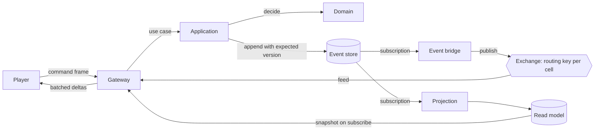

# Architecture

Villages is an event-sourced world with a map-first client. Commands are decided by pure functions, the resulting
events are the only durable state, and everything a player sees is a projection of those events. The client is a view
over a stream of changes, not a simulation of its own.

Two separations carry the whole design. On the backend, the game domain knows nothing about Occurrent, MongoDB,
RabbitMQ or Spring. On the frontend, the game client knows nothing about React, the DOM, MapLibre or Pixi. Both are
enforced by the build and by tests, not by discipline alone.

## Dependency rules

Backend, arrows pointing the way dependencies are allowed to go:

```
domain  <-  application  <-  infrastructure-occurrent
                          <- infrastructure-rabbit
                          <- projections
                          <- gateway            <-  app
        <-  protocol      <- gateway
```

- `domain` depends on the Kotlin standard library and nothing else. No Spring, no Occurrent, no MongoDB, no RabbitMQ,
  no CloudEvents, no Jackson, no logging framework.
- `application` depends only on `domain`. It holds the use cases and owns the ports, as interfaces, that
  infrastructure implements.
- Adapters depend inwards, never on each other, with one exception: the broker and the projections need the event
  store adapter in order to subscribe to it.
- Only `app` has a Spring Boot application class and the configuration that wires ports to adapters.

Frontend:

```
packages/protocol  <-  packages/client-core  <-  apps/web
```

- `client-core` is compiled without DOM type definitions, so a stray `window`, `WebSocket` or `document` fails to
  typecheck. The socket arrives as an injected interface.
- Restricted imports forbid React, MapLibre and Pixi inside `client-core` and `protocol`.

Enforcement: Gradle module edges plus architecture tests on the backend; workspace dependencies, a DOM-free compiler
configuration and lint rules on the frontend. A violation fails the build, in both cases proven by a deliberate
violation when the rule was introduced.

## Modules

| Module | Holds |
|---|---|
| `domain` | The house aggregate: commands, events, state, the decide and evolve functions, value types, domain errors |
| `application` | Use cases and the ports they need: command execution, read model queries, the clock, player tokens |
| `protocol` | The client and server message types, shared with the frontend through checked-in JSON fixtures |
| `infrastructure-occurrent` | CloudEvent conversion and type mapping, the MongoDB event store, the application service, durable subscriptions |
| `infrastructure-rabbit` | Broker topology, the bridge that publishes stored events, and the feed the gateway consumes |
| `projections` | Read models. The first is houses by cell, which the map is drawn from |
| `gateway` | Player connections, cell subscriptions, snapshots, coalesced deltas, command intake |
| `app` | The Spring Boot bootstrap and the wiring. The only module that knows every other one |
| `arch-tests` | The layer rules, as tests |
| `load-bots` | The swarm that proves the scale numbers |

Packages are shorter than module names: `villages.domain`, `villages.application`, `villages.protocol`,
`villages.occurrent`, `villages.rabbit`, `villages.projections`, `villages.gateway`, `villages.app`,
`villages.bots`. The two infrastructure modules take the name of the thing they wrap, which is also their
commit scope.

Deployment starts as one process. The gateway is written as though it were already separate, so extracting it later is
a configuration change rather than a rewrite.

## How a change travels



A player founds a house. The gateway hands the command to the application, which loads the stream, calls `decide`,
and appends the resulting events with the stream version as the write condition. Two subscriptions read the store from
there: one updates the read model, one publishes to the broker with a routing key that carries the cell. Every gateway
node consumes that feed, matches each event against the cells its sessions are watching, and pushes a coalesced batch.
A newly subscribed client is served a snapshot from the read model first, and drops any delta it has already seen.

## Scale principles

1. One stream per house, and no global aggregate. Anything world-shaped is a projection.
2. Resources are rates. Events are emitted when something changes, never on a clock, so idle players cost nothing.
3. The world is partitioned into cells. Routing keys, subscriptions and read model queries all use the same cell, and
   the cell is computed once, in the domain, and carried on the event.
4. Gateway nodes are stateless apart from their live connections: one broker consumer per node, an in-memory index
   from cell to sessions, and no stickiness required from a load balancer.
5. Pushes are coalesced per session on a short timer, and outbound queues are bounded. A client that cannot keep up is
   told to resynchronise rather than being allowed to grow a queue.
6. The map is drawn from read models. The event store is never queried to render anything.
7. Every principle above is checked by the bot swarm, not assumed. Ten thousand connections on one development
   machine is the Phase 2 milestone.

## Events over time

Event types are versioned by name and catalogued in the event catalogue, which a test parses. Until the
world-persistence milestone the store may be wiped instead of migrated, which is what makes early experimentation
cheap; after it, changes need upcasters. The decision records carry the reasoning.
