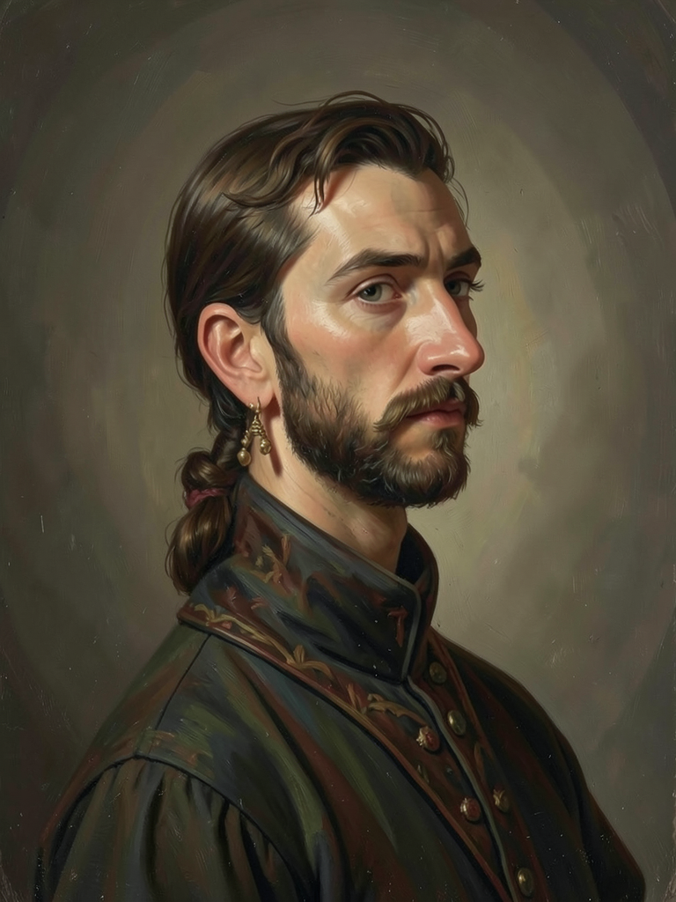
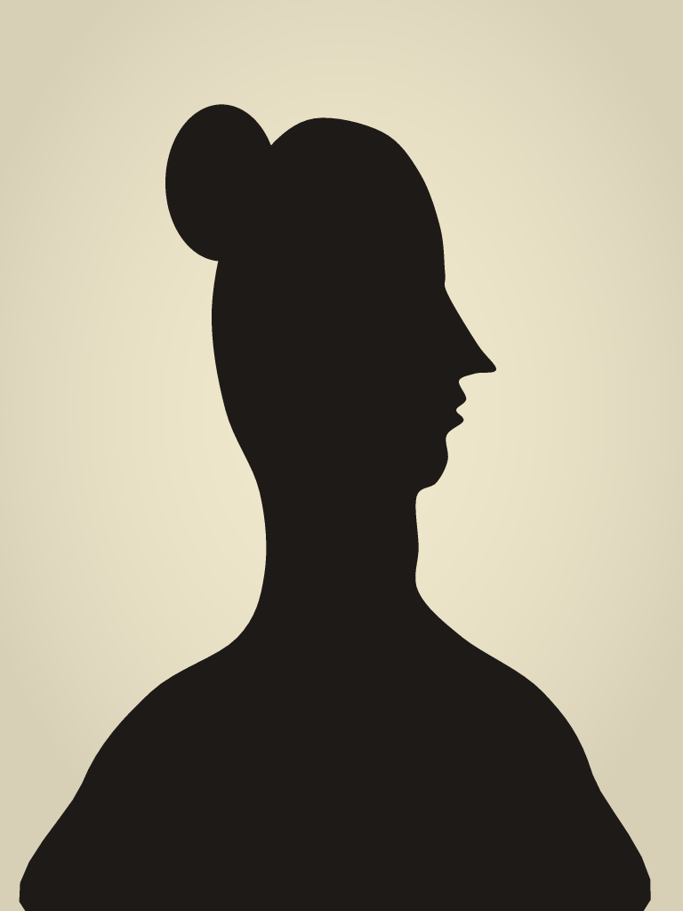
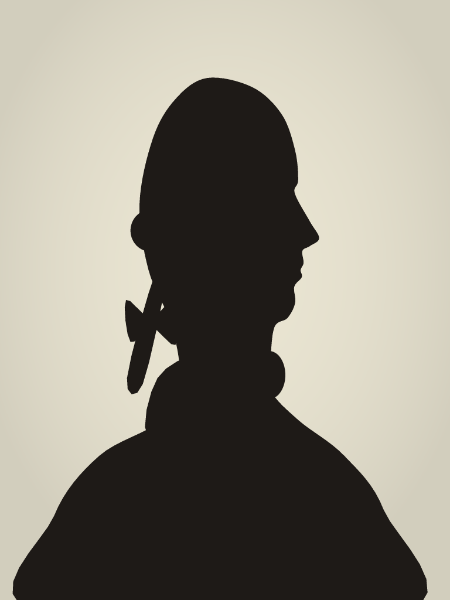
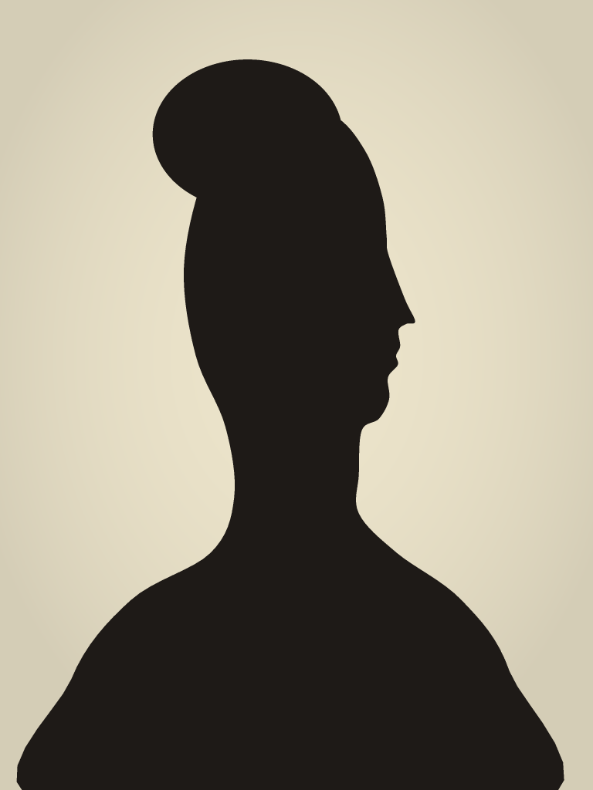
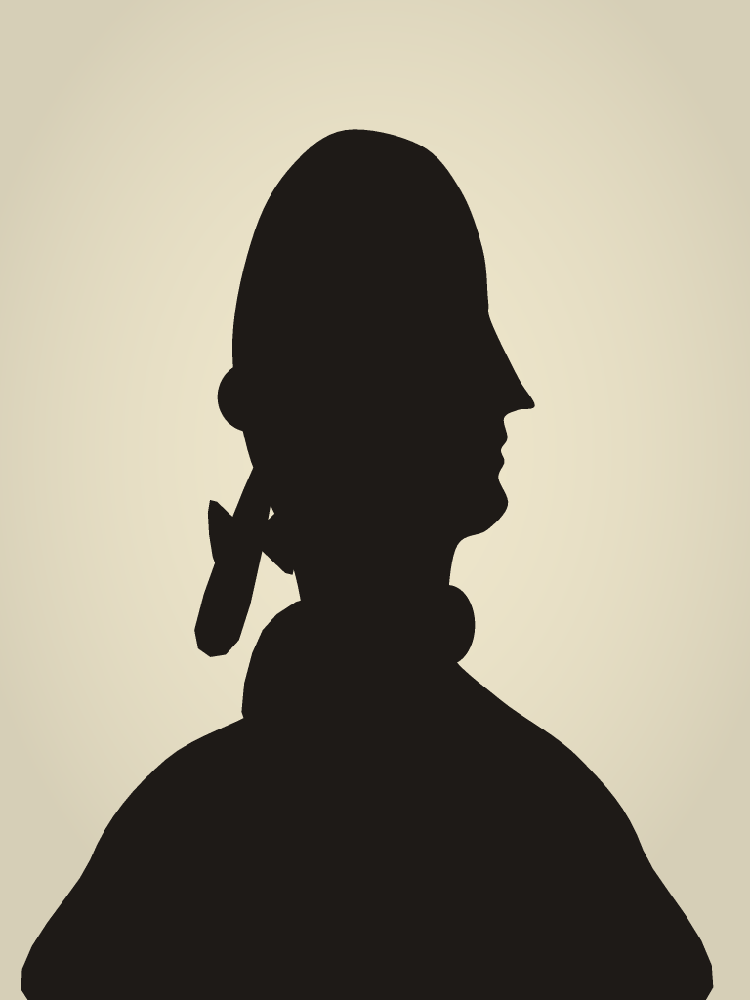
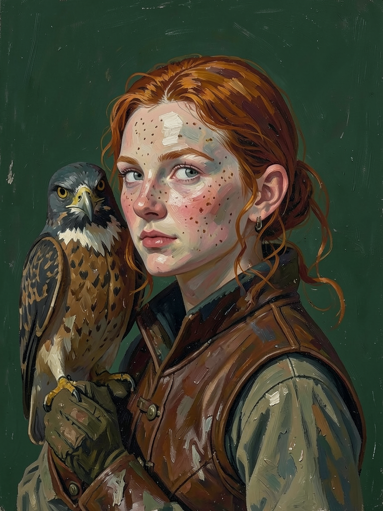

# The story

> **What belongs here:** the world's history told in order, as the timeline at `/admin/inspect-story` draws it -
> what happened and when, and beside it the lore a reader needs to follow it - from the first light of reason to the
> first of January 1790, where the houses begin; and later, the campaign they play. **What does not:** what the
> world is made of and how its time works, which `SETTING.md` records and the lore here only retells; what a player
> does in it (`MECHANICS.md`); how the page is drawn (`RUNNING.md`).

This is the truth of the world, and no player begins knowing any of it: `SETTING.md` says why nothing in the
interface may state it. It is Adam's story, told with him a few boxes at a time. Where a box of lore retells what
`SETTING.md` records, `SETTING.md` is the record and the box follows it; where the story settles something
`SETTING.md` left open, `SETTING.md` and the glossary follow the story.

Begun 2026-10-16.

## How it is written

One voice from the first box to the last: a chronicle read aloud in a high hall, grand and unhurried, in the past
tense until the last box, which is the present. Every box says one thing in a few sentences. The gods are energies
and not people, so a god is *it*, never he or she.

## How it is kept

The page draws this document as it stands, read through the dev server and drawn again whenever it is saved, so no
build of the game carries it. It reads it by these rules, and says at its top where one is broken:

- A `##` heading with boxes under it is a **part** of the story, drawn as a heading across the line, and what is
  said between it and its first box is its opening. A `##` with no boxes, like this one, is about the document and
  is not drawn.
- A `###` heading is a **box**: `### 1785 · The ritual`. Before the ` · ` is when it happened - a year, a span, a
  day - and after it, its name. A box with no ` · ` happened at no one time, and stands on the line without a date.
  A box whose *when* is `Lore` is not something that happened but something that is so, and is drawn apart from the
  events, on parchment.
- A `####` heading is an **invention**: `#### 1440 · The printing press`, its real year and its name and nothing
  under them, standing small to the left of the line at its place in time. The inventions are Earth's own, with the
  years a reader would find in a book, and nothing is said of them but that.
- A paragraph under a box is its words, and `*a word*` is said in italics.
- A paragraph of nothing but pictures, ``, is a row of them,
  each in an oval with its words under it: under the box's own words, or alone on the line in a box with none. Only
  portraits stand in the story yet. The paths are the files' own, so a preview of this document shows them too.
- The last box of the story is **now**, and the line ends there.

## The background

How the world came to be as the houses find it on the first of January, 1790.

#### 1440 · The printing press

### 1600 · The first light

In the years about 1600 the world began to ask *how*, where before it had only asked *who*. Lenses were ground and
turned upon the heavens, presses multiplied like rooks in spring, and in a handful of cities learned men met to try
the world rather than recite it. It was the smallest of lights, and it did not go out.

#### 1608 · The telescope

#### 1642 · Pascal's calculator

#### 1643 · The barometer

#### 1656 · The pendulum clock

#### 1668 · The reflecting telescope

### The 1700s · An age grown through the old

For near two centuries the light spread: instruments and academies, encyclopaedias and almanacs, letters crossing
seas between people who would never meet. It swept nothing away. Castles still stood and were still worth the
holding, a cathedral was still the greatest thing for a hundred miles, and the new grew up through the old as a
sapling grows through a broken wall.

#### 1712 · Newcomen's steam engine

#### 1714 · The mercury thermometer

#### 1733 · The flying shuttle

#### 1735 · The marine chronometer

#### 1745 · The Leyden jar

#### 1752 · The lightning rod

### Lore · What the gods are

The gods are no pantheon that some people dreamed and might as easily forget. They are energies, and they cling to
what people are and what people do - to courage and to grief, to the furrow and the hearth, to the hunger to know -
as frost clings to a branch, so long that they believe themselves born of it. They were not: they came out of the
far dark, so long ago that they have forgotten it.

### Lore · The faces they wear

Each age hands the gods a shape, and they wear it a while. The Greeks gave them faces and names, which they wore
for some centuries and then set down, and they do not answer to those names now. Whoever knows a god by its Greek
face knows only a costume.

### The gods take fright

The gods watched the light spread, and they did not like what they saw. They feared it was not good for the people
they clung to: that a people who measured everything might come to love nothing, and would forsake the furrow, the
forest and the turning year for the lamp, the ledger and the clock.

### Many minds among the gods

They did not fear it alike. Those who dwell in the soil and the seasons saw fields forsaken for cities; those of
the hearth saw families scattered after wages and letters; those of holy dread saw the thunder explained and the
dark of the cathedral lit, until nothing was left to tremble at. And some feared only that things were changing, as
old things will.

#### 1764 · The spinning jenny

#### 1769 · Watt's steam engine

### The ritual resolved

So they resolved to turn humankind back toward the green world, and their instrument was to be a ritual. Not flood
nor plague, but a quiet weight laid on every mind at once, a leaning toward the field and the forest that each would
feel as a longing of their own. It would take only a little of each person's will, they told one another, and only
for their own good.

### The three who would not

Three of the gods would not have it. To take a choice from a person, however gently and for whatever good, was to
them the one thing that may not be done; and they loved the light besides, and wished to see how far it would go.
They gave the council their word, and in secret they set about its undoing.

### Lore · Oriel, the lifted face

Oriel clings wherever someone looks up and wonders: to windows and lenses, to the night sky, to the face of a child
asking why. Of the three it loved the new age best, for the age was made of the very thing it was. It was the
boldest of them, and took the greatest part of the work upon itself.

### Lore · Veyra, the held breath

Veyra dwells in the moment of choosing: the crossroads, the held breath before *yes* or *no*, the hand that
hesitates over the seal. A ritual to lean upon every will at once struck at the very thing it is, and it was Veyra
who first said aloud that it must not be done.

### Lore · Merrin, the word passed on

Merrin dwells in words passed between strangers: in letters and presses, in the margins of borrowed books, in every
lesson given to someone the teacher will never see again. Patient and careful, it learnt the ritual's weave thread
by thread, and found where it could be made to fail.

#### 1783 · The hot-air balloon

#### 1785 · The power loom

### 1785 · The ritual

In 1785 the gods gathered, and the ritual began. Every one of them gave something to the working, and it rose over
the world like weather: a pressure every living mind would feel as a longing for the soil, the seasons and the wild.

### 1785 · Those who felt it

Nearly all who felt the working felt only a longing, and took it for their own. But in every faith there were a few
who had spent their lives learning the weight of their own thoughts - in cloisters and lodges and mountain hermitages, in
silence kept for years - and they felt it for what it was: a weight laid upon them from outside. They could not have
said whose. They knew only that it was not theirs.

### 1785 · The sabotage

At the height of the working the three pulled on the threads they had laid in it, and they succeeded: not one mind
was bent. But a working of that size does not simply fail. It warped, in a manner none of them had foreseen and none
of them could stop.

### 1785 · The world warped

The warping ran out through everything the gods cling to, which is to say through everything. Coastlines slid,
rivers sought new beds and the land took shapes no map had ever held; and the people on it were bent with it, though
none of them could have said how.

### 1785 · Where the minds were many

A city is many minds held close, and the ritual had leaned upon every mind at once; so it bore down hardest where
minds were thickest, on every town, and on the great cities most of all, where a hundred thousand wills lay packed
together street on street. When
the working twisted, it was there the twist took hold. The weight that was meant to turn each mind toward the green
sank into the streets with no mind left to turn, and poisoned the very space between the houses: a crowd's thoughts
with no crowd to think them, hanging in the air like smoke that will not clear.

### 1785 · Oriel is lost

Oriel did not survive it. Caught at the heart of the working as it twisted, the god of the lifted face was torn
apart, and what it had been was flung out past the sky and scattered in the dark between the stars, beyond any
calling back. It flies outward still, toward the place the gods have forgotten they came from. Those who look up at
night still wonder; but they wonder alone.

### 1785–1790 · The withered gods

Every god came out of the working withered, thin as the last light of evening and weaker than it had ever been.
None of them is sure what happened. Whether the working failed by flaw or by treachery the council cannot tell, the
two who remain of the three hardly know what they have made, and in the confusion every god watches every other.

### 1785–1790 · The fall of the cities

In the years that followed, the cities fell: every town that had stood in 1785, and the great ones worst. Their people grew strange in streets that whispered at them, and
fled, or fought, or stayed too long; fires were set and not put out, and what the fires spared, neglect undid. By
1790 the greatest names of the old world lay in ruins, and where the old order fell with them, new factions rose into
the gap, and some of what rose was nothing anyone would have chosen.

### Lore · The ruins of the old towns

People have learnt to shun the ruins of the towns and cities of old, and the great ones most of all. Riches lie in them still, where they were dropped -
plate and coin, libraries, strongrooms no one came back for - and there are always some who go to fetch them. Not all
return; and of those who do, some come home wanting things they never wanted, and are no longer sure which of their
thoughts are their own.

### 1786–1789 · What rose into the gap

Every great body of the old world had kept its head in a city - the Curia and the Porte, the Companies' courts in
London and Amsterdam, the academies, the courts of the crowns - and when the cities fell, the heads fell with them.
But the bodies had never lived in the cities. The abbeys in their valleys, the fleets at sea, the stewards on the
estates and the couriers on the roads were spared, for the weight had lain lightest where minds were few; and each
grew a new head in open country, and found the others along the old roads and sea lanes. They rose faster than
anything made by people rises, and it was not only people who raised them.

### 1786–1789 · The chains knotted

Every faith had kept hidden chains of teaching, passed hand to hand from master to pupil, and some were underground
already: the Jesuits, suppressed in 1773; the Illuminati of Bavaria, banned in the very year of the ritual; the Sufi
lodges, the Rosicrucians, the White Lotus. Those who had felt the weight were in them, and in the years after the
fall they found one another by letter and by sign, faith reaching across to faith, because each had felt the same
thing. What they knotted together had never had a head that anyone could see, and so it had none to lose.

### Lore · The Vigil

The Vigil is no faith, and it lives inside every one: a brotherhood with a lodge by every great ruin, a province over
every stretch of the world and the Seven over all, each circle knowing the one above it only by secret names. It
quarrels over what its founders felt - a judgement to atone for, holy places to walk again, or something from
outside that was not God at all. It does not know what feeds it: the gods of holy dread, who have their dark again
in the ruins, and who would rather the Vigil did not look too closely at what it felt.

### 1785–1790 · What clung to the families

Not every energy that withered was one of the council. Many were too thin to hold to anything great, and to keep
from fading they seized upon a family - any family, it seemed, chosen by nothing - and clung to it as a drowning
thing clings to a spar. The families never knew. They only found that they had become, somehow, a house.

### Lore · Strangers at the gate

The withered gods walk among people now, in the faces this age hands them: a stranger at the gate, a guest who
stays. Each of them wants something, and their hunger leads to the ruins. Beware the guest who never grows older,
whose face is known in another hall under another name.

### 1 January 1790 · Now

And so the world stands on the first of January, 1790: bent out of its old shape, its towns and cities in ruins, its
gods withered and at odds, its people sure only that something has gone wrong. Every explanation they are offered is mistaken: a bad run of years,
a judgement, somebody's fault, the weather. Into this world the houses come.

   
